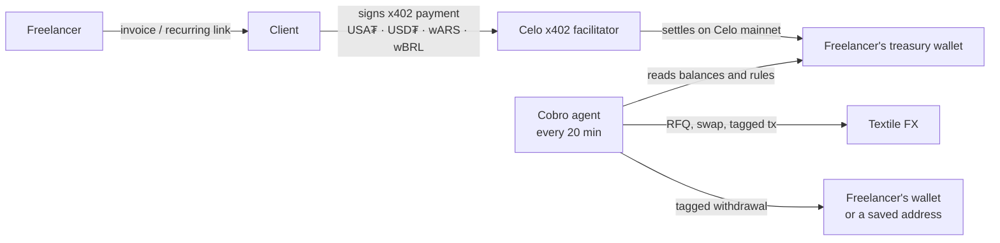

# Cobro

**Get paid in dollars or pesos. Your agent protects the rest.**

Cobro is an invoicing and treasury agent for Latin American freelancers whose clients already hold
stablecoins. The freelancer sends an invoice; the client pays it on Celo in USA₮, USD₮, wARS or wBRL; an
agent then keeps a spending reserve in the freelancer's local currency and moves the rest into dollars
through Textile FX, inside limits the freelancer sets.

- App: <https://cobro-agent.vercel.app>
- Agent identity (ERC-8004): agent [#9884 on 8004scan](https://8004scan.io/agents/celo/9884), agent card at
  [`/agent-card.json`](https://cobro-agent.vercel.app/agent-card.json)
- Agent wallet: [`0x64ad…ae78`](https://celoscan.io/address/0x64ad61211c1b0b7f20b3e04b49661f30f152ae78)
- Built for the Celo [Agents on Open Rails](https://www.loops.house/agents-on-open-rails) hackathon.

## Who it is for

A designer in Buenos Aires or a developer in São Paulo who works for crypto companies, DAOs and web3 teams.
Those clients already hold stablecoins and want to pay without bank rails. The freelancer wants three things:
a professional invoice the client can pay in one step, money that does not lose value while it sits, and
pesos or reais on hand for rent and groceries. Cobro does not touch bank accounts or cards; it starts where
the money is already onchain.

## How it works



1. **Invoice.** The freelancer signs in with an email (a Para wallet is created in the background), picks a
   home currency (USD, ARS or BRL) and issues a one-off or weekly/monthly recurring invoice. A recurring
   invoice has one link (`/r/…`) that always opens the period that is due.
2. **Pay.** The client opens the link, chooses a currency, connects a wallet (MiniPay, MetaMask, Rabby) and
   signs. Payment runs over [x402](https://x402.celo.org) through Celo's facilitator, so the client pays no
   gas. Local-currency amounts use a locked Textile reference rate.
3. **Protect.** Every 20 minutes the agent looks at each treasury. It keeps the reserve the freelancer set in
   wARS or wBRL and converts the excess into USD₮ through a Textile FX RFQ, within a per-trade and a daily
   limit. Depending on the approval mode (automatic, ask before selling dollars, or ask every time) it
   proposes a trade and waits for the freelancer's approval. Gas is paid in stablecoins.
4. **Withdraw.** The freelancer withdraws to their own wallet or to saved addresses. A new address needs an
   email code and becomes usable only after 24 hours, so a hijacked session cannot drain the treasury.

## Tracks

### Stable Agents: LatAm (Ripio × Celo)

- **Works on mainnet with a real wFIAT token** — an ARS invoice was paid in wARS on Celo mainnet and the agent
  then swapped the excess wARS into USD₮ on Textile FX on its own; wBRL takes the same path (supported, not yet
  run on mainnet). Every transaction Cobro sends carries the
  entry's attribution tag (see [Attribution](#attribution)).
- **Real use of wFIAT and the Celo stack** — wFIAT is the reserve the freelancer spends; x402 through Celo's
  facilitator for payments, ERC-8004 identity for the agent, gas paid in stablecoins, Para server wallets.
- **Agent autonomy and usefulness** — the agent decides on its own when to convert, how much, and when to
  stop: reserve target, per-trade and daily caps, `no_quote` and slippage handling, approval modes, one open
  trade per freelancer, every decision logged in the activity feed.
- **UX a real person can use** — email sign-in, no seed phrase, amounts in the freelancer's own currency,
  token units and addresses behind a "Details" disclosure, one-step payment page for the client.
- **Impact for LatAm** — built for LatAm freelancers paid by stablecoin-holding clients; real usage is in
  [Real usage](#real-usage).

### Open Corridors: USA₮ with x402

- **Real settlement on mainnet** — Cobro accepts USA₮ on its payment page and settles it through Celo's x402
  facilitator on mainnet, the same path wARS and USD₮ invoices already took. Settled USA₮ payments appear in
  [Real usage](#real-usage).
- **A named counterparty outside the team** — Cobro is opening to outside freelancers and their clients; payments
  from clients outside the team are listed by role in [Real usage](#real-usage) as they happen, and only those
  count as independent.
- **Repeat flow from the same counterparty** — weekly and monthly recurring invoices bring the same client
  back every period on the same link.
- **Why USA₮ matters to that user** — the client is often a US company or a web3 team that wants to pay in a
  US-regulated dollar (issued by Anchorage Digital Bank under the GENIUS Act framework); the freelancer
  receives a dollar that does not lose value against the peso. The payment page recommends USA₮ for US
  clients, and x402 makes it gasless: the client only signs. Clients new to USA₮ get a
  [step-by-step guide](docs/guides/pay-with-usat.md).

### Open Corridors: Textile FX

Filler: in progress. Cobro will run a quoting agent (filler) on Textile FX that prices from the flow its own
treasuries need to convert. This section is updated when it is live.

## Real usage

Numbers below are generated by [`scripts/usage-stats.mts`](scripts/usage-stats.mts) from Cobro's database and
Celo mainnet, never typed by hand. A paying client counts as **independent** only when its wallet is not one
of the team's, was not first funded by a team wallet, and had Celo activity before the hackathon started
(2026-10-06 12:00 UTC). People are named by role only.

<!-- usage:start -->
_Not generated yet._
<!-- usage:end -->

## Attribution

- Every transaction Cobro sends — agent swaps, approvals and withdrawals from the treasury wallets, and the
  operator's transactions — appends the entry's ERC-8021 attribution tag `celo_bc3965e128ba`
  (`createOperatorClient` in [`src/lib/chain/clients.ts`](src/lib/chain/clients.ts) for the operator,
  `tagCalldata` in [`src/lib/chain/treasury-tx.ts`](src/lib/chain/treasury-tx.ts) for treasury wallets).
- x402 payments are settled by the Celo facilitator, which submits the transaction itself and does not add an
  app tag (its `/supported` endpoint lists no builder-code extension). Every Cobro settlement goes through
  Cobro's facilitator API key, and `payTo` is the freelancer's Cobro treasury wallet.
- `npx tsx scripts/verify-tx.ts <tx hash>` decodes the tag of any transaction.

## Architecture

- **App:** Next.js 16 (App Router, Cache Components) on Vercel; Tailwind v4 and shadcn/ui.
- **Data:** Neon Postgres through Drizzle ORM; migrations in [`drizzle/`](drizzle).
- **Wallets:** Para — email sign-in for freelancers, one Para server wallet per treasury.
- **Payments:** x402 v2 (`@x402/core`, `@x402/evm`) with Celo's facilitator.
- **FX:** Textile FX v2 RFQ API (preview, firm quote, swap, submit).
- **Agent loop:** `/api/cron/treasury`, called every 20 minutes by cron-job.org, with a GitHub Actions
  backup in [`.github/workflows/treasury-cron.yml`](.github/workflows/treasury-cron.yml).

| Folder | What lives there |
|---|---|
| [`src/lib/invoices`](src/lib/invoices) | invoices, recurring schedules, stored invoice numbers |
| [`src/lib/payments`](src/lib/payments) | x402 resource server, quotes, settlement and reconciliation |
| [`src/lib/treasury`](src/lib/treasury) | the agent: engine, rules, approvals, executor, withdrawals, P&L |
| [`src/lib/fx`](src/lib/fx) | Textile reference rates and RFQ client |
| [`src/lib/chain`](src/lib/chain) | tokens, viem clients, attribution tagging |
| [`src/lib/identity`](src/lib/identity) | ERC-8004 registry and agent card |
| [`src/lib/addresses`](src/lib/addresses) | saved withdrawal addresses with email codes and the 24-hour wait |
| [`src/app`](src/app) | pages: landing, `/app` dashboard, `/pay/[slug]`, `/r/[slug]`, API routes |

## Run locally

```bash
npm install
cp .env.example .env.local   # fill in the values; localhost uses Para BETA and a Neon dev branch
npm run db:migrate
npm run dev
```

Before a change is done: `npm test && npm run typecheck && npm run lint && npm run build`.

## For clients

Paying a Cobro invoice in USA₮ for the first time? Read [Paying a Cobro invoice in USA₮](docs/guides/pay-with-usat.md).
